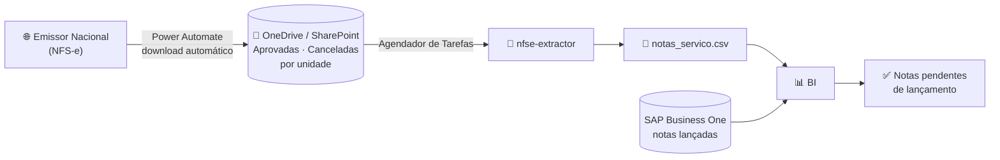
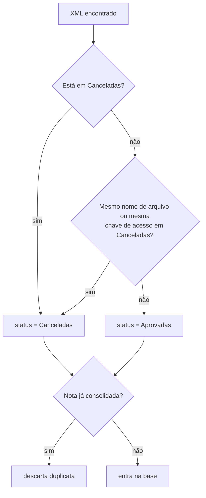

<div align="center">

# 🧾 NFS-e Extractor

**Automação fiscal que transforma XMLs de NFS-e em uma base pronta para conciliação com o ERP.**

[](https://github.com/arthurgomesf/nfse-xml-to-csv/actions/workflows/ci.yml)


</div>

> **TL;DR (EN)**: a scheduled ETL that parses Brazilian service invoices (NFS-e, national standard XML),
> applies fiscal business rules (cancellation detection, purchase-order extraction from free text,
> invoice number normalization) and outputs a CSV consumed by a BI dashboard that reconciles
> invoices against SAP Business One. Pure Python standard library, fully tested.

## ▶️ Demonstração rápida

Copie e execute em ordem no terminal do Windows, PowerShell ou Git Bash (requer Python 3.11+ e Git):

```bash
# 1. Baixar o projeto (pule se já estiver na pasta)
git clone https://github.com/arthurgomesf/nfse-xml-to-csv.git
cd nfse-xml-to-csv

# 2. Criar o ambiente virtual e instalar
python -m venv .venv
.venv/Scripts/python -m pip install -e .

# 3. Processar as NFS-e de exemplo e abrir o relatório
.venv/Scripts/nfse-extractor -c exemplos/config.toml --relatorio
```

O terminal mostra o resumo do processamento, a base é gravada em `exemplos/saida/notas_servico.csv`
e um relatório com os dados extraídos abre no navegador. No Linux/macOS, troque `.venv/Scripts/` por `.venv/bin/`.

---

## 📌 O problema

No setor fiscal, toda nota de serviço recebida precisa ser **lançada no ERP (SAP Business One)**.
A conferência era manual: abrir o portal, baixar as notas, comparar uma a uma com o que já estava no
sistema. Além de lento, o processo tinha uma armadilha. **Uma nota pode ser baixada ainda autorizada e
ser cancelada dias depois**, e aí corria o risco de ser lançada (ou continuar lançada) indevidamente.

## 💡 A solução

Um pipeline automatizado, de ponta a ponta, sem intervenção manual:



1. Um fluxo do **Power Automate** baixa os XMLs do portal e separa em pastas `Aprovadas/` e `Canceladas/`, uma estrutura por unidade da empresa.
2. O **Agendador de Tarefas do Windows** executa este projeto.
3. O extrator lê todos os XMLs, aplica as regras fiscais e gera **uma base única em CSV**.
4. O **BI** cruza essa base com as notas lançadas no SAP B1 e mostra o que está pendente, o que foi cancelado e o que não tem pedido de compra.

## ✨ Funcionalidades

- **Leitura do leiaute nacional da NFS-e** (`http://www.sped.fazenda.gov.br/nfse`): prestador, tomador, valores, ISS, NBS, substituição de nota.
- **Detecção de cancelamento**: nota presente nas duas pastas é tratada como cancelada e entra **uma única vez** na base.
- **Extração do pedido de compra em texto livre**: 10 padrões de regex cobrem as variações que fornecedores usam na descrição ("Pedido de Compra Nº", "Ordem de Compra", "Ref. pedido", "Número do pedido:"...), com o campo estruturado `xPed` como reserva.
- **Normalização do número da nota** para casar com o ERP (`2600000000123` → `123`).
- **Chave de conciliação** `CNPJ do prestador + número da nota`, usada pelo BI para cruzar com o SAP B1.
- **Multiunidade**: quantas empresas/filiais forem necessárias, via arquivo de configuração.
- **Resiliente**: XML corrompido (download interrompido) é ignorado e registrado no log, sem derrubar a execução.
- **Seguro para o BI**: escrita atômica do CSV, e se uma pasta não for encontrada (OneDrive fora de sincronia), **a base anterior é preservada**.
- **Exportação opcional para SQLite**.
- **Zero dependências externas**: só a biblioteca padrão do Python.

## 🚀 Começando

**Requisitos:** Python 3.11+

```bash
git clone https://github.com/arthurgomesf/nfse-xml-to-csv.git
cd nfse-xml-to-csv
python -m venv .venv
source .venv/Scripts/activate   # PowerShell: .venv\Scripts\activate · Linux/macOS: source .venv/bin/activate
pip install -e .
```

### Rode a demonstração

O repositório inclui [NFS-e fictícias](exemplos/notas) que cobrem os cenários principais: nota cancelada
depois do download, nota substituta, pedido de compra em formatos diferentes e um XML corrompido.

```bash
nfse-extractor -c exemplos/config.toml
```

```text
16:52:37 INFO    Matriz: 4 XML(s) em Aprovadas, 1 em Canceladas
16:52:37 WARNING Ignorado NFSe_download_interrompido.xml: XML malformado (no element found: line 31, column 20)
16:52:37 INFO    Filial: 3 XML(s) em Aprovadas, 0 em Canceladas
16:52:37 INFO    CSV gravado em exemplos\saida\notas_servico.csv
16:52:37 INFO    Unidade         Aprovadas  Canceladas   Total
16:52:37 INFO    Matriz                  3           1       4
16:52:37 INFO    Filial                  2           0       2
16:52:37 INFO    TOTAL                                       6
16:52:37 WARNING 1 arquivo(s) ignorado(s) por erro de leitura.
16:52:37 INFO    Concluído em 0.01s.
```

Resultado (recorte de [`exemplos/saida/notas_servico.csv`](exemplos/saida/notas_servico.csv)):

| nfse_numero | emit_nome                          | pedido_compra | data_emissao | valor_servico | unidade   | status         | Chave             |
|-------------|------------------------------------|---------------|--------------|---------------|-----------|----------------|-------------------|
| 12          | Delta Transportes e Logística Ltda | 4500190       | 12/03/2026   | 2380.50       | Matriz    | **Canceladas** | 4455566600015412  |
| 101         | Alfa Manutenção Industrial Ltda    | 4500123       | 02/03/2026   | 4850.00       | Matriz    | Aprovadas      | 11222333000181101 |
| 57          | Beta Soluções em TI Ltda           | 4500188       | 05/03/2026   | 12300.00      | Matriz    | Aprovadas      | 2233344400017257  |
| 233         | Gama Engenharia e Projetos Ltda    | 4500201 ¹     | 11/03/2026   | 18750.00      | Matriz    | Aprovadas      | 33444555000163233 |
| 118         | Alfa Manutenção Industrial Ltda    | 4500310       | 18/03/2026   | 3120.00       | Filial    | Aprovadas ²    | 11222333000181118 |

<sub>¹ sem pedido na descrição: veio do campo `xPed` · ² nota substituta: `subst_chave` aponta para a nota original</sub>

### Configure para uso real

```bash
cp config.example.toml config.toml     # o config.toml fica fora do Git
```

```toml
[saida]
csv = 'C:\SharePoint\Notas de Serviço\notas_servico.csv'
# sqlite = 'C:\SharePoint\Notas de Serviço\notas_servico.db'

[[unidades]]
nome = "Matriz"
pasta = 'C:\SharePoint\Notas de Serviço\Emissor Nacional - Matriz'   # contém Aprovadas\ e Canceladas\

[[unidades]]
nome = "Filial"
aprovadas = 'C:\outro\caminho\Aprovadas'      # ou informe as pastas separadamente
canceladas = 'C:\outro\caminho\Canceladas'
```

### Opções da linha de comando

```text
nfse-extractor [-c CONFIG] [-o SAIDA] [--sqlite BANCO] [--relatorio] [-v]

  -c, --config   arquivo TOML (padrão: ./config.toml)
  -o, --saida    caminho do CSV (sobrepõe a configuração)
  --sqlite       também grava a base em SQLite
  --relatorio    ao final, abre um relatório HTML com os dados (para demonstração)
  -v, --verbose  log arquivo a arquivo
```

| Código de saída | Significado |
|:---:|---|
| `0` | Base gerada com sucesso (arquivos ilegíveis aparecem como `WARNING`) |
| `1` | Configuração inválida, pasta inexistente ou falha ao gravar (ex.: CSV aberto no Excel). **A base anterior não é alterada.** |

### Agendamento no Windows

No **Agendador de Tarefas**, crie uma tarefa com a ação *Iniciar um programa*:

| Campo | Valor |
|---|---|
| Programa/script | `C:\caminho\nfse-xml-to-csv\.venv\Scripts\nfse-extractor.exe` |
| Argumentos | `-c "C:\caminho\nfse-xml-to-csv\config.toml"` |

Como os caminhos relativos do `config.toml` são resolvidos a partir do próprio arquivo, a tarefa
funciona independente da pasta de trabalho. O código de saída `1` faz o agendador registrar a falha.

## 📐 Regras de negócio

### 1. Cancelamento



O robô baixa a nota enquanto ela está autorizada. Se ela for cancelada depois, aparece **também** em
`Canceladas/`. A versão cancelada prevalece, e cada nota entra **uma única vez** na base (identificada
pela chave de acesso de 50 dígitos). A regra é aplicada **dentro de cada unidade**.

### 2. Pedido de compra

Fornecedores raramente preenchem o campo estruturado `xPed`. O número do pedido costuma vir escrito
na descrição do serviço. O extrator testa os padrões do mais específico ao mais genérico
([`regras.py`](src/nfse_extractor/regras.py)):

| Texto na descrição | Pedido extraído |
|---|---|
| `Manutenção conforme Pedido de Compra Nº 4500123` | `4500123` |
| `Ordem de Compra nº 4500126` | `4500126` |
| `Suporte mensal - número do pedido: 4500315` | `4500315` |
| `Ref. pedido 4500188` | `4500188` |
| `Contrato 998877 - conforme pedido de compra nº 4500200` | `4500200` (o padrão explícito vence o número solto) |
| `Projeto elétrico da linha 4` + `<xPed>4500201</xPed>` | `4500201` (reserva: campo `xPed`) |

### 3. Número da nota e chave de conciliação

Alguns municípios retornam o número com prefixo de ano e zeros (`2600000000123`). Números com mais de
10 dígitos têm o prefixo `AA + zeros` removido, para o número casar com o lançado no ERP. A coluna
`Chave` = `CNPJ do prestador + número normalizado` é o elo entre esta base e o SAP B1 no BI.

## 📖 Dicionário de dados

A ordem e o nome das colunas são o **contrato com o BI** e não mudam entre versões.

| Coluna | Origem no XML (`infNFSe/...`) | Descrição |
|---|---|---|
| `nfse_id` | `@Id` (sem o prefixo `NFS`) | Chave de acesso da NFS-e (50 dígitos) |
| `nfse_numero` | `nNFSe` | Número da nota, normalizado |
| `subst_chave` | `DPS/infDPS/subst/chSubstda` | Chave da nota substituída, se houver |
| `subst_motivo_codigo` | `DPS/infDPS/subst/cMotivo` | Código do motivo da substituição |
| `subst_motivo_descricao` | `DPS/infDPS/subst/xMotivo` | Descrição do motivo da substituição |
| `nfse_DPS` | `DPS/infDPS/nDPS` | Número da DPS (declaração de prestação de serviço) |
| `pedido_compra` | `xDescServ` (regex) ou `serv/infoCompl/xPed` | Pedido de compra |
| `data_emissao` | `DPS/infDPS/dhEmi` | Data de emissão (`dd/mm/aaaa`) |
| `emit_cnpj` | `emit/CNPJ` | CNPJ do prestador |
| `emit_nome` | `emit/xNome` | Razão social do prestador |
| `emit_im` | `emit/IM` | Inscrição municipal do prestador |
| `toma_cnpj` | `DPS/infDPS/toma/CNPJ` | CNPJ do tomador (unidade da empresa) |
| `toma_nome` | `DPS/infDPS/toma/xNome` | Razão social do tomador |
| `valor_servico` | `DPS/infDPS/valores/vServPrest/vServ` | Valor do serviço |
| `base_calculo` | `valores/vBC` | Base de cálculo do ISS |
| `aliquota_iss` | `valores/pAliqAplic` | Alíquota aplicada (%) |
| `valor_iss` | `valores/vISSQN` | Valor do ISS |
| `valor_liquido` | `valores/vLiq` | Valor líquido da nota |
| `codigo_nbs` | `DPS/infDPS/serv/cServ/cNBS` | Código NBS do serviço |
| `descricao_servico` | `DPS/infDPS/serv/cServ/xDescServ` | Descrição do serviço |
| `unidade` | *configuração* | Unidade/empresa dona da pasta |
| `status` | *regra de cancelamento* | `Aprovadas` ou `Canceladas` |
| `Chave` | `emit_cnpj + nfse_numero` | Chave de conciliação com o ERP |

## 🏗️ Arquitetura

```text
src/nfse_extractor/
├── config.py     # leitura e validação do config.toml
├── leitor.py     # XML → campos brutos (mapeamento declarativo coluna ↔ XPath)
├── regras.py     # funções puras: pedido de compra, número da nota, datas
├── pipeline.py   # leitura das pastas, regra de cancelamento, deduplicação
├── exportar.py   # CSV (atômico) e SQLite
└── cli.py        # linha de comando, logs e resumo
tests/            # testes unitários e de ponta a ponta (+ doctests nos módulos)
exemplos/         # NFS-e fictícias e configuração de demonstração
```

Cada camada tem uma responsabilidade. As regras fiscais são **funções puras** (sem I/O), testáveis
isoladamente. O mapeamento XML → coluna é **declarativo** ([`CAMPOS_XML`](src/nfse_extractor/leitor.py)),
então incluir um campo novo é uma linha.

## 🧠 Decisões técnicas

- **CSV como formato de entrega.** Testei SQLite como base para o BI. Funcionou, mas um arquivo `.db`
  no OneDrive é difícil de compartilhar e exige driver ODBC na máquina de quem consome. O CSV no
  SharePoint é lido nativamente pelo BI e por qualquer pessoa do time. O SQLite ficou como saída opcional.
- **Biblioteca padrão apenas.** `xml.etree`, `csv`, `sqlite3` e `tomllib` resolvem o problema. Sem
  `pandas`, a instalação na máquina que roda o agendador é trivial e não quebra com atualizações.
- **Falhar antes de sobrescrever.** Se o OneDrive não sincronizou uma pasta, gerar uma base parcial
  seria pior do que não gerar nenhuma: o BI mostraria notas lançadas como pendentes. Por isso pasta
  ausente interrompe a execução e o CSV anterior é mantido.
- **Escrita atômica.** O CSV é gravado em um arquivo temporário e substituído em uma única operação,
  então uma atualização do BI no meio da gravação nunca lê dados pela metade.
- **Encoding `utf-8-sig`.** O BOM garante que Excel e ferramentas de BI leiam acentos corretamente sem configuração.

## 🔄 Do script ao projeto

Este repositório é a evolução de um script que rodou em produção no setor fiscal. A refatoração manteve
o contrato com o BI (mesmas colunas, mesmos valores) e corrigiu pontos que só aparecem com o tempo:

| Script original | Versão atual |
|---|---|
| Caminhos fixos no código | Arquivo de configuração TOML |
| Regra de cancelamento repetida para cada unidade | Uma regra para N unidades |
| Nota cancelada aparecia **duas vezes** na base (uma por pasta) | Uma linha por nota, deduplicada pela chave de acesso |
| Prefixo `26` fixo no número da nota (**quebraria em 2027**) | Funciona para qualquer ano |
| Um XML corrompido interrompia toda a execução | Arquivo ignorado e reportado no log |
| Pasta ausente gerava um *traceback* | Mensagem clara com a unidade e o caminho |
| CSV gravado direto no destino | Escrita atômica: o BI nunca lê a base pela metade |
| `pandas` como dependência | Somente biblioteca padrão |
| Sem testes | Testes unitários, de ponta a ponta e doctests, com lint e CI em Windows e Linux |

## 🧪 Desenvolvimento

```bash
pip install -e ".[dev]"
pytest                 # testes + doctests
ruff check . && ruff format --check .
```

## 🗺️ Próximos passos

- [ ] Baixar os XMLs direto da API do Ambiente de Dados Nacional (ADN), sem depender do Power Automate
- [ ] Exportar em Parquet com valores numéricos tipados
- [ ] Relatório de notas sem pedido de compra identificado

## 📄 Licença

[MIT](LICENSE). Feito por **Arthur Gomes**.
